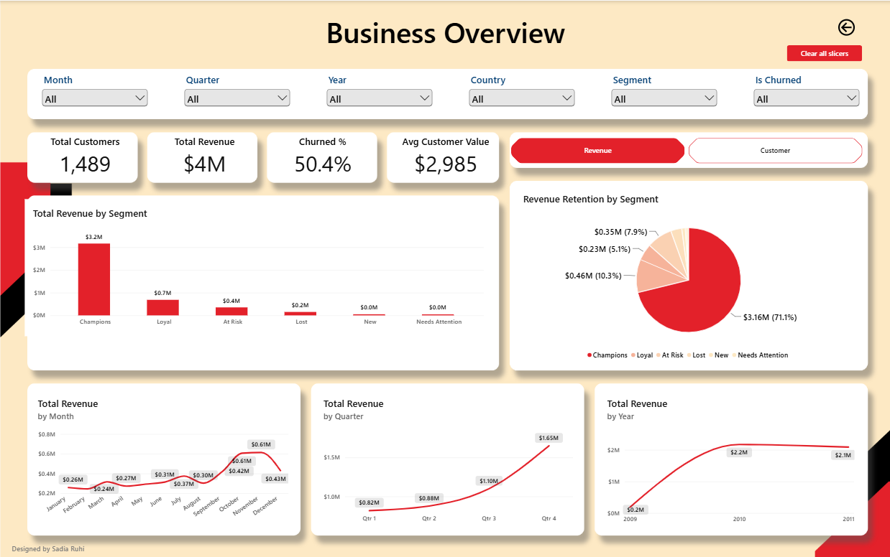
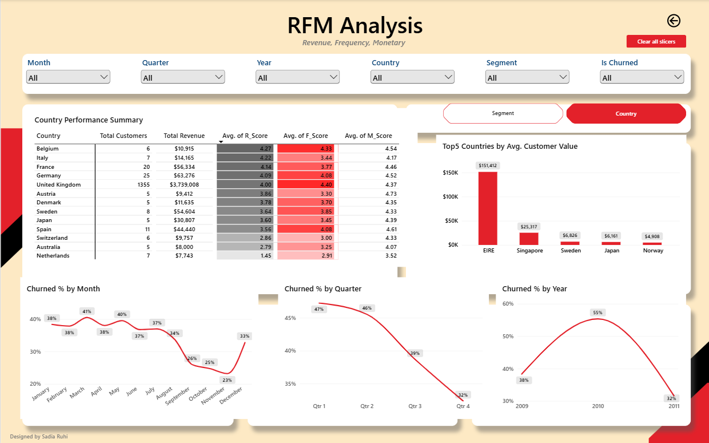

# Nokshi Home: Customer Analytics & RFM Segmentation

**An end-to-end data analytics project using SQL Server, Python, and Power BI**

**Author:** Sadia Afrin Ruhi

## ⚠️ Disclaimer
*Nokshi Home is a fictional company name created for this educational portfolio project. It is not affiliated with any real corporation. All financial figures and business metrics shown in this project are derived entirely from a public, anonymized transactional dataset (UCI Online Retail II) and do not reflect any real company's actual performance.*

## 📌 Project Overview
This project simulates a real-world analytics engagement for a fictional Bangladeshi online furniture and home decor brand, Nokshi Home. The goal was to take raw, messy transactional data and transform it into a decision-ready business intelligence dashboard. The workflow mirrors a real corporate environment: define the business problem first (via a BRD), clean and validate the data in SQL, build the analytical logic in Python, and deliver insights through an interactive Power BI report.

## 🧠 Thinking Process & Strategic Decisions
I chose a furniture brand because furniture has a longer buying cycle than groceries, making RFM analysis particularly effective for identifying repeat buyers and high-value wholesale clients. I started by writing a Business Requirements Document to define exactly what business decisions this analysis needed to support. 

**Strategic Data Sampling for Efficiency:**
The original raw dataset contained over 1 million rows. While a SQL database can easily handle this volume, exporting 1M+ rows to a local machine for Python processing and Power BI visualization introduces significant latency and performance bottlenecks. 

To optimize the pipeline for speed and seamless user experience on the final dashboard, I executed a strategic, randomized sampling query in SQL. By randomly selecting 1,500 unique customers and extracting all their associated transactions (resulting in a robust sample of **~210,000 rows**), I maintained the statistical validity of the RFM segments while drastically improving processing speed and dashboard load times. 

## 🎯 Business Problem
Nokshi Home wants to identify its most valuable customers and reduce churn among customers who are at risk of leaving. Leadership currently has no structured view of customer value, so retention efforts are reactive instead of targeted.

## 🔍 Key Findings
* **Revenue Concentration:** A small segment of "Champion" customers is driving the vast majority of total revenue.
* **Churn Risk:** Overall churn sits at ~50.4% (using a 90-day inactivity threshold), indicating a significant risk to baseline revenue.
* **Seasonality:** Revenue shows clear seasonal spikes, likely correlating with holiday seasons or specific furniture sales events.

## 📊 The Dashboard
**Business Overview:**
    

**RFM Analysis & Geography:**

## 🛠️ Tools and Tech Stack
* **SQL Server (SSMS):** Data import, cleaning, deduplication (`ROW_NUMBER`), and randomized customer sampling.
* **Python (Jupyter Notebook):** RFM calculation, customer scoring (`pandas`), and churn flagging.
* **Power BI Desktop:** 3-page interactive dashboard using custom DAX measures and a custom JSON theme.
